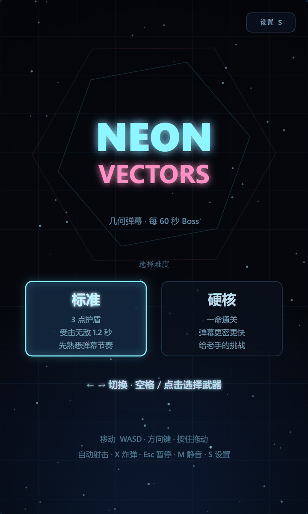
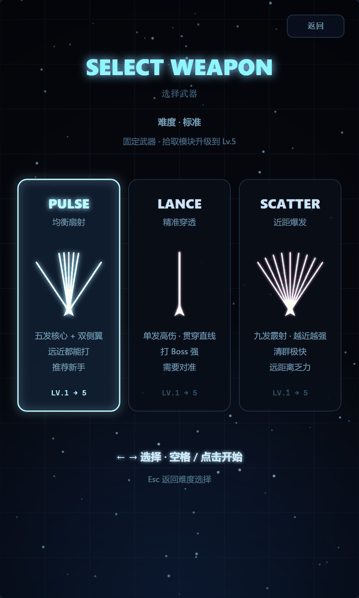
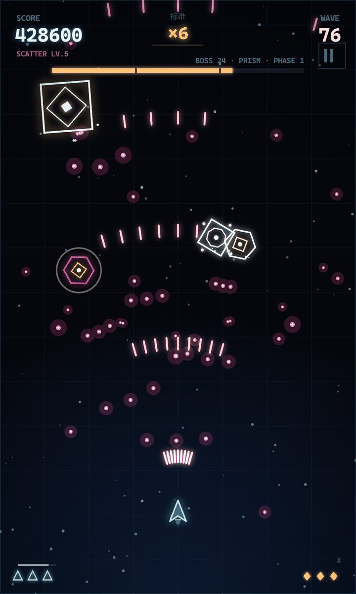
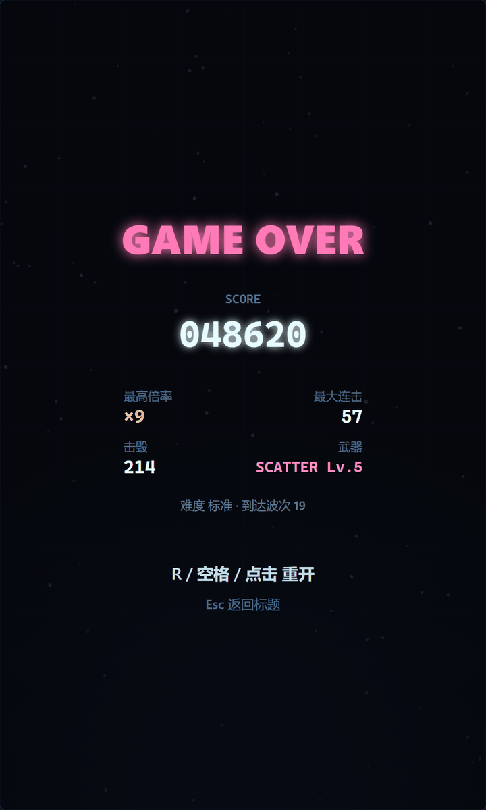

# NEON VECTORS 项目总结

> 竖屏几何弹幕射击游戏 · 纯 Canvas 2D 绘制 · 零运行时依赖

**在线试玩**：<https://15876167663.github.io/NEON-VECTORS/>  
**代码仓库**：[GitHub](https://github.com/15876167663/NEON-VECTORS) · [Gitee](https://gitee.com/itcastutil/neon-vectors)  
**当前版本**：v1.5.0（2026-11-28）

<p align="center">
  
</p>
<p align="center"><em>标题页 · 难度选择与霓虹几何视觉</em></p>

---

## 1. 项目概况

| 项目 | 内容 |
| --- | --- |
| 游戏类型 | 竖屏几何弹幕射击 / 无尽模式 |
| 目标平台 | 桌面浏览器与移动端浏览器 |
| 技术栈 | Vite + 原生 ES Modules + Canvas 2D + WebAudio |
| 逻辑分辨率 | 480 × 800，按窗口等比缩放，DPR 上限 2 |
| 单局目标时长 | 3–5 分钟 |
| 开发周期 | 2026-11-27 22:39 — 2026-11-28 00:28 |
| 提交记录 | 12 次提交，v0.1 → v1.5.0 |
| 代码规模 | 24 个源文件，约 3107 行（JS + CSS） |

项目采用“垂直切片”方式迭代：每个版本都保持可运行、可构建、可部署，再逐步加入敌人、成长、Boss、音频、武器与后期数值曲线。

---

## 2. 核心玩法

**核心循环**：读弹幕走位 → 自动射击击杀 → 拾取能量核心续连击 → 压力上升 → 炸弹救场 → 死亡结算 → 立即重开。

### 2.1 难度

| 难度 | 护盾 | 受击无敌 | 出怪间隔 | 敌弹速度 |
| --- | --- | --- | --- | --- |
| 标准 | 3 | 1.2 秒 | ×1.0 | ×1.0 |
| 硬核 | 1 | 无 | ×0.85（更密） | ×1.12 |

### 2.2 三种武器

开局三选一，局内只升级、不切换；拾取模块可升到 Lv.5。

| 武器 | 定位 | 优势 | 弱点 |
| --- | --- | --- | --- |
| PULSE | 均衡扇射 | 五发核心 + 双侧翼，容错高 | 单发伤害低 |
| LANCE | 精准穿透 | 单发高伤、贯穿直线，跟枪打 Boss 最快 | 需要对准，清群弱 |
| SCATTER | 近距爆发 | 宽扇多弹，贴脸清群与打 Boss 极强 | 远距离乏力 |

<p align="center">
  
</p>
<p align="center"><em>开局武器三选一 · 独立弹道与射速</em></p>

### 2.3 敌人与 Boss

| 敌人 | 行为 | 弹幕 |
| --- | --- | --- |
| 六边形核心 | 缓慢下潜 | 三连瞄准弹 |
| 尖刺突进 | 横向冲刺 | 扇形散射 |
| 炮台 | 悬停上方 | 旋转弹幕环 |

Boss 每约 60 秒出现一次，三种形态 `HEX → ORBIT → PRISM` 每 3 场循环，各有三阶段专属弹幕。阶段切换包含 1 秒无敌、缓动换位、敌弹吸收与护盾演出。

<p align="center">
  
</p>
<p align="center"><em>第 24 场 PRISM Boss · 后期弹幕与 ×6 连击</em></p>

### 2.4 成长与容错

- 连击倍率最高 ×8，90px 内近身击杀额外 +1，结算展示最高倍率与最大连击。
- 能量核心延长连击窗口，并积累护盾充能。
- 每局 3 枚炸弹，清空敌弹并提供短暂无敌，不打断连击。
- 武器模块每 8 次击杀或炮台掉落，Lv.5 约在 46–61 秒达成。

<p align="center">
  
</p>
<p align="center"><em>结算页 · 分数、最高倍率、最大连击与武器等级</em></p>

### 2.5 音频与表现

- 音效与 BGM 全部由 WebAudio 实时合成，无音频文件。
- 合成器包含压缩器、卷积混响、64 步音序器与 Boss 高强度节奏。
- 命中定格、击杀慢动作、开火预警圈、震屏、粒子与逐帧 HUD 动效。
- 设置支持主音量、音效/BGM 独立开关、震动、画质高低与恢复默认。

---

## 3. 版本演进

| 版本 | 主要内容 |
| --- | --- |
| v0.1 | 核心手感：移动、自动射击、碰撞、护盾、死亡重开、粒子、震屏、双难度 |
| v0.2 | 三种敌机、四套弹幕、波次导演、炸弹、无敌帧、暂停 |
| v0.3 | 能量核心、武器 1–5 级、近身加成、连击 HUD、结算页 |
| v0.4 | 三阶段 Boss、警报演出、弹幕切换、阶段结算 |
| v0.5 | WebAudio 音效、合成 BGM、命中定格、击杀慢动作、弹幕预警 |
| v1.0 | 数值平衡、设置面板、移动端适配、GitHub Pages 部署 |
| v1.1 | 三种 Boss 形态轮换与专属弹幕，每 3 场循环 |
| v1.2 | 阶段切换无敌帧、缓动换位、敌弹吸收与护盾演出 |
| v1.3 | 收窄 4/5 级核心散布，重调 Boss 血量曲线 |
| v1.4 | 开局武器三选一、独立弹道/射速/伤害与武器选择页 |
| v1.4.1 | 修复炮台预警圈负半径导致的画面永久冻结 |
| v1.5 | 无尽后期出怪与弹幕继续收紧，Boss 血量上限 380→470 |

---

## 4. 技术实现

### 4.1 目录结构

```text
src/
  main.js            启动、画布适配、固定步长主循环
  config.js          数值、配色、难度与后期曲线
  input.js           键盘、鼠标与触屏输入
  audio.js           WebAudio 音效与合成 BGM
  settings.js        本地设置、画质与震动
  core/draw.js       多边形、圆角矩形与文字工具
  game/              Game 场景调度、出怪导演、弹幕模式、武器
  entities/          玩家、敌人、Boss、子弹、粒子、拾取物
  render/            程序化背景与 HUD
  scenes/            标题、设置、武器选择、战斗
```

### 4.2 主循环

- 固定 60Hz 逻辑步长，使用累加器补帧，单帧最多补 5 步。
- `requestAnimationFrame` 在帧函数开头续订，更新与渲染包裹在 `try/catch` 中；即使出现单帧异常，渲染循环也不会永久中断。
- 页面切后台时自动暂停，避免累积时间造成“回到前台瞬间跳帧”。

### 4.3 渲染

- 480×800 逻辑坐标，按窗口比例缩放，DPR 上限 2，兼顾清晰度与性能。
- 玩家子弹与敌弹分别合批到少量 Path 中绘制，降低 Canvas 状态切换开销。
- 背景网格、星点、辉光、Boss 与 HUD 全部程序化生成，无图片资源。
- 低画质模式减少粒子数量与背景星点。

### 4.4 音频

- 振荡器 + 噪声缓冲 + 双二阶滤波 + 增益包络合成音效。
- 总线结构：`master → limiter → destination`，音效/BGM 分别走总线并送入卷积混响。
- BGM 使用 64 步音序器，Boss 阶段自动提升 BPM 与鼓点密度。

### 4.5 数据驱动

- 难度、武器、Boss 血量、连击、拾取、后期曲线集中在 `config.js` 与 `weapons.js`。
- 调整数值不需要改战斗逻辑，便于批量模拟与回归验证。

### 4.6 回归测试

- 使用 Node 内置 test runner，零新增依赖，`npm test` 即可运行；GitHub Actions 每次推送先测试再构建。
- 覆盖炮台预警圈在极端负计时下的半径边界，防止再次出现绘制异常停帧。
- 覆盖 Boss 血量曲线：前 12 场固定、后期增长且不超过 470 上限。

---

## 5. 数值与平衡

### 5.1 基线

| 项目 | 数值 |
| --- | --- |
| 玩家移速 | 330 px/s |
| 判定半径 | 6 px（视觉 14 px） |
| 射速 | PULSE 7.5 / LANCE 4.5–5.7 / SCATTER 4.2–5.0 发/秒 |
| 出怪间隔 | 1.5 s → 0.5 s（60 秒后继续收紧至 0.42 s） |
| Boss 血量 | 170 起，每场 +16，470 封顶 |

### 5.2 后期曲线

v1.5 的目标是“前 12 场不变，后期继续成长”：

- 出怪间隔在 60 秒后按时间继续收紧，最低 0.42 秒。
- 六边形核心射击间隔下限从 0.9 秒降到 0.68 秒。
- Boss 血量上限从 380 提到 470，第 12 场仍为 346。

30 分钟无射击压力测试中，敌弹峰值从 145 提升到 197（约 +36%）；满级玩家 1 分钟与 30 分钟的清场速度不再完全相同。

### 5.3 Boss 击杀时间

12 种子平均，玩家保持安全距离并跟随 Boss 移动：

| 场次 | PULSE | LANCE | SCATTER 远距 | SCATTER 贴脸 |
| --- | --- | --- | --- | --- |
| 第 12 场 | 18.0 s | 14.2 s | 20.1 s | 7.9 s |
| 第 16 场 | 21.3 s | 16.3 s | 22.9 s | 9.2 s |
| 第 20 场 | 24.6 s | 19.6 s | 26.7 s | 10.1 s |
| 第 24 场 | 24.4 s | 19.3 s | 27.2 s | 10.2 s |

SCATTER 贴脸数据显著更快，这是“高风险高收益”的武器定位，未做全局削弱。

### 5.4 长时稳定性

- 三武器各跑 20 分钟机器人 soak：Boss 17–18 场，最大敌弹 146，最大粒子 173。
- 敌弹、玩家子弹、粒子与拾取物数组均有自然淘汰或上限，没有失控增长。

---

## 6. 稳定性复盘：画面永久冻结

### 6.1 现象

长时间游玩后画面完全停住，游戏时间不再推进，只能刷新页面。

### 6.2 定位过程

1. 先用真实 `PlayScene` 做 30 分钟逻辑压测，三把武器均无数组失控，排除纯逻辑死循环。
2. 再在真实浏览器复现，捕获到：

```text
IndexSizeError: Failed to execute 'arc' on 'CanvasRenderingContext2D':
The radius provided (-0.675556) is negative.
    at warnRing (src/entities/enemy.js)
    at TurretEnemy.draw
```

3. 根因：炮台从高空下降时，射击倒计时持续递减为负数，预警圈半径被算成负值，`ctx.arc()` 抛异常。
4. 异常发生在渲染阶段，而原主循环把 `requestAnimationFrame` 放在函数末尾，异常后不再续帧，画面永久冻结。

### 6.3 修复

- 钳制预警圈进度与半径，半径最小 4px。
- 炮台到达悬停位后才开始射击倒计时，从源头避免负计时。
- 主循环改为先续帧再更新/渲染，并加异常兜底；单帧错误只记录日志，不再中断整个游戏。

### 6.4 验证

- 强制 `shootT = -5` 的极端场景：零报错，游戏时间持续推进。
- 5 个高空炮台同屏运行 15 秒：零报错，时间从 79.4s 推进到 93.5s。
- 20 分钟三武器 soak：无异常，数组稳定。
- 音频节点排查：25 秒仅 5 个活跃节点，内存约 5MB，排除音频泄漏。

---

## 7. 工程与发布

| 指标 | 数值 |
| --- | --- |
| 构建工具 | Vite 8.4 |
| 运行时依赖 | 0 |
| 生产 JS | 56.42 KB（gzip 18.35 KB） |
| 生产 CSS | 0.74 KB |
| 回归测试 | Node test runner，2 个用例，CI 自动执行 |
| 文档配图 | 4 张 720×1200 PNG，合计约 455 KB |
| 部署 | GitHub Actions → GitHub Pages |
| 镜像 | Gitee |

GitHub Actions 在每次推送 `main` 后自动构建并发布；Vite 使用相对路径 `base: './'`，可部署到任意子目录。

---

## 8. 复盘

### 做得好的地方

- 垂直切片节奏清晰，每个版本都有可玩内容与明确验收标准。
- 数值调整基于真实战斗逻辑批量模拟，而不是只凭感觉改数。
- 面对“玩久了卡死”先复现、再定位根因，没有用提示或自动重载掩盖问题。
- 纯程序化绘制与合成音频，资源体积小、部署简单、风格统一。
- 双远程仓库 + 自动部署，交付链路完整。

### 不足与风险

- 自动化测试仅覆盖两个高风险回归点；绘制、音频与移动端仍缺少浏览器级测试。
- 机器人模拟不能替代真实手感，移动端长时游玩与音频解锁仍需真机验证。
- 内容量仍偏小：只有 3 种敌机、3 种 Boss 形态，缺少分裂体等进阶敌人。
- 没有本地排行榜、成就或每日挑战，长线留存主要靠无尽分数。
- 演示视频尚未制作；如果作为课程交付，需要补一段实机录像。

### 关键经验

- 绘制代码也会抛异常，主循环必须保证“异常不中断续帧”。
- 整数血量的倍率缩放会在阈值处突然跳档，连续型参数更适合做平滑曲线。
- 长时稳定性要同时看逻辑数组、渲染负担、音频节点与浏览器事件，不能只压测其中一层。

---

## 9. 后续方向

1. **v1.6 本地战绩与排行榜**：最高分、最高波次、Top 5 记录、结算页 `NEW RECORD`。
2. **v1.7 分裂体敌人**：死亡分裂为子体，加入后期出怪池，并重新做一轮数值与性能验证。
3. **v1.8 每日种子 / 成就**：固定随机种子、每日挑战、成就解锁。
4. **可选**：PWA 离线游玩、云排行榜、回放系统、演示视频。

---

## 10. 运行方式

```bash
npm install
npm run dev      # 本地开发
npm test         # Node 内置回归测试
npm run build    # 生产构建
npm run preview  # 预览构建结果
```

完整设计与平衡记录见 [DESIGN.md](./DESIGN.md)，操作说明见 [README.md](./README.md)。
